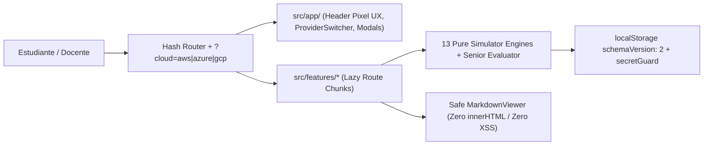

# Cloud Engineering Academy — Multicloud Engineering, Simulators & Senior Mode


> **Fuente única de verdad:** Plataforma educativa interactiva multicloud (**AWS, Microsoft Azure y Google Cloud**) con **fuente única de versión en `package.json`** sincronizada automáticamente hacia `Ajustes` y respaldos JSON (`appVersion`). Conserva íntegros los **291 archivos base de V9** (`docs/FILE_MANIFEST_V10.json`, `removed: []`). El historial completo V1–V10 se preserva en [`CHANGELOG.md`](CHANGELOG.md) y `docs/RELEASE_NOTES_V*.md`.

---

## 2. Tabla de Contenidos

1. [Header & Alcance Honesto](#cloud-engineering-academy--multicloud-engineering-simulators--senior-mode)
2. [Tabla de Contenidos](#2-tabla-de-contenidos)
3. [Descripción General y Capacidades](#3-descripción-general-y-capacidades)
4. [Stack Tecnológico](#4-stack-tecnológico)
5. [Arquitectura General](#5-arquitectura-general)
6. [Estructura del Repositorio y Ownership](#6-estructura-del-repositorio-y-ownership)
7. [Quick Start (< 10 minutos)](#7-quick-start--10-minutos)
8. [Variables de Entorno y Configuración Local](#8-variables-de-entorno-y-configuración-local)
9. [Contratos Internos y Esquemas de Datos](#9-contratos-internos-y-esquemas-de-datos)
10. [Estrategia de Pruebas](#10-estrategia-de-pruebas)
11. [Pipeline CI/CD y Cadena de Suministro](#11-pipeline-cicd-y-cadena-de-suministro)
12. [Despliegue Estático y Sandbox Local Docker/Kind](#12-despliegue-estático-y-sandbox-local-dockerkind)
13. [Checklist del Desarrollador (Pre-PR)](#13-checklist-del-desarrollador-pre-pr)
14. [Solución de Problemas Frecuentes (Troubleshooting)](#14-solución-de-problemas-frecuentes-troubleshooting)
15. [Contribución, Marcas y Licencia Educativa](#15-contribución-marcas-y-licencia-educativa)

---

## 3. Descripción General y Capacidades

**Cloud Engineering Academy** entrena criterio real de ingeniería en la nube sin exigir tarjetas de crédito ni exponer cuentas productivas:

- **Currículo estructurado de 18 módulos y 90 unidades únicas (`UnitContentSpec`):** Dividido en *Nivel 1: Fundamentos (60h)*, *Nivel 2: Ingeniería (80h)* y *Nivel 3: Arquitectura (100h)* con teoría propia, antipatrones reales, diagramas SVG accesibles, comparador multicloud, micro-retos GoPixel, glosario global y banco de **90 preguntas razonadas** que conservan `bestScore`.
- **13 Simuladores deterministas en navegador:** CIDR (reservas reales AWS=5, Azure=5, GCP=4), IAM (`Explicit Deny > Allow > Implicit Deny`), Autoescalado, SLO, Architecture Studio, **Routing & Firewall Lab (con topología 3D en Three.js)**, Terraform Plan & Drift, Kubernetes Scheduler, Load Balancing & Backpressure, FinOps, Disaster Recovery RTO/RPO, Messaging/DLQ/Outbox y Observability Burn-Rate.
- **Senior Mode (18 incidentes × 3 nubes = 54 investigaciones nativas):** Flujo en 4 etapas (`Investigar → Diagnosticar → Decidir → Informe`) con contrapruebas (*Red Herrings*), `IncidentTimeline`, `CodeReviewLab`, exportación Postmortem/ADR (`.md` y `.json`), checkpoints portables aislados por nube y rúbrica docente local no autenticada.
- **60 Prácticas y Laboratorios en 3 Modalidades:** Simulador en navegador, kit local reproducible (`labs/local-sandbox/` con Docker Compose y Kind) y guía segura para cuenta cloud propia con filtro preventivo local anti-secretos (`secretGuard`).

> **Límites éticos y operativos honestos:** Esta aplicación es una SPA estática local. No autentica usuarios contra servidores, no despliega infraestructura real desde el navegador, no consulta precios cloud en vivo y sus puntajes miden **completitud formativa**, nunca certificación oficial de AWS, Microsoft ni Google.

---

## 4. Stack Tecnológico

| Capa | Tecnología | Rol en el Proyecto |
|---|---|---|
| **UI & Estado Reactivo** | Preact `10.27` + `@preact/signals` `2.2` | Renderizado ligero y estado reactivo aislado por proveedor (`?cloud=aws\|azure\|gcp`). |
| **Lenguaje** | TypeScript `5.9` (`strict: true`) | Contratos de dominio, motores puros de simulación y declaraciones `.d.mts` sin `any`. |
| **Bundler** | Vite `7.1` | Code-splitting por ruta (`index-*.js < 60 KB` gzip) e importación estática `?raw` de guías. |
| **Visualización 3D / SVG** | Three.js `0.187` (lazy) + SVG declarativo | Inspección interactiva de saltos de red 3D y diagramas topológicos de 4 capas cero-CLS. |
| **Calidad & Formato** | Biome `2.6` (`preset: "recommended"`) | Linter estricto (`biome ci src tests scripts`) y formateador determinista. |
| **Testing** | `node:test` + BDD Gherkin + Playwright `1.56` + `@axe-core/playwright` | Pirámide completa: unitarios puros, especificaciones BDD en español, E2E Chromium y auditoría WCAG 2.2 AA. |

---

## 5. Arquitectura General



Documentación detallada de capas e invariantes en [`docs/ARCHITECTURE.md`](docs/ARCHITECTURE.md).

---

## 6. Estructura del Repositorio y Ownership

```text
.
├── src/
│   ├── app/                  # Shell global, AppHeader, AppFooter, CloudProviderSwitcher y router Hash
│   ├── components/           # Componentes transversales accesibles (CodeBlock, ConfirmDialog, GlossaryModal, MarkdownViewer, CloudMentor)
│   ├── config/               # Metadatos sincronizados desde package.json (appMeta.ts)
│   ├── data/                 # Catálogo curricular, 90 UnitContentSpecs, quizBank, glosario y 18x3 expedientes Senior
│   ├── design-system/        # Fuentes WOFF2 auto-alojadas (fonts.css) y tokens WCAG 2.2 AA (tokens.css)
│   ├── domain/               # ProviderRegistry, métricas, parser Markdown seguro y clasificación de riesgo CLI
│   ├── features/             # Módulos de dominio desacoplados (< 250 líneas/archivo, 0 imports cruzados):
│   │   ├── about/            # Metodología, Seguridad Cloud, Privacidad y No afiliación
│   │   ├── curriculum/       # Catálogo Aprender y Mapa Curricular (/mapa)
│   │   ├── home/             # Portada, Hero cero-CLS, onboarding y tira de servicios 2026
│   │   ├── labs/             # Catálogo global de 60 labs, 3 modalidades, metadatos y exportador de evidencias
│   │   ├── lessons/          # Aula de 90 unidades, micro-juegos GoPixel y evaluaciones
│   │   ├── progress/         # Dashboard de 6 dimensiones e importación/exportación global validada
│   │   ├── projects/         # 3 Proyectos integradores con rúbricas al 100% y generador ADR (.md)
│   │   ├── senior/           # Consola Senior Mode en 4 etapas, Timeline, CodeReviewLab y revisión docente
│   │   ├── settings/         # Preferencias de movimiento reducido y borrado granular por nube/caso
│   │   └── simulators/       # 13 motores puros + laboratorio 3D Three.js
│   ├── lib/                  # Persistencia versionada, migraciones V1-V9->V2, checkpoints y secretGuard
│   └── shared/ui/            # Primitivas visuales puras e iconografía SVG pixel-art 16x16 crispEdges
├── labs/                     # 54 guías por nube, 3 OIDC, Terraform enterprise-finops.tf y kit local-sandbox/
├── public/                   # Assets originales de mascota, 54 guías Senior, fuentes WOFF2 locales y _headers CSP/HSTS
├── schemas/                  # Esquema JSON de revisión docente local (instructor-review.schema.json)
├── scripts/                  # Gates de integridad SHA-256, escaneo de secretos, auditoría SAST, SBOM y bundle budget
├── tests/                    # Pruebas unitarias, suites BDD Gherkin (tests/bdd/) y Playwright E2E (tests/e2e/)
└── docs/                     # Arquitectura, Accesibilidad, Autoría, Seguridad Cloud, Runbooks y Manifiestos V3-V10
```

---

## 7. Quick Start (< 10 minutos)

**Prerrequisitos:** Node.js `>= 22.0.0` y npm `>= 10` (sin cuentas cloud ni variables secretas requeridas).

```bash
# 1. Instalar dependencias exactas desde package-lock.json
npm ci

# 2. Verificar salud del entorno y dependencias
npm run doctor

# 3. Levantar servidor local de desarrollo (http://localhost:5173)
npm run dev
```

Para compilar y previsualizar el bundle estático de producción:
```bash
npm run build
npm run preview
```

---

## 8. Variables de Entorno y Configuración Local

La SPA estática **no requiere archivo `.env`** para ejecutarse ni compilarse (cero credenciales en navegador). Para el kit opcional de práctica en contenedores (`labs/local-sandbox/`), todas las variables son efímeras locales y están documentadas en [`labs/local-sandbox/.env.example`](labs/local-sandbox/.env.example):

| Variable | Requerida | Default | Propósito (Exclusivo `labs/local-sandbox`) |
|---|---|---|---|
| `SANDBOX_DB_NAME` | No | `cea_lab` | Base de datos PostgreSQL aislada en red interna Docker. |
| `SANDBOX_DB_USER` | No | `cea_student` | Usuario local efímero sin privilegios externos. |
| `SANDBOX_DB_PASS` | No | `local_ephemeral_only_change_me` | Contraseña local efímera (nunca reutilizar claves reales). |
| `SANDBOX_HTTP_PORT` | No | `8088` | Puerto enlazado únicamente a `127.0.0.1` (cero exposición `0.0.0.0`). |

---

## 9. Contratos Internos y Esquemas de Datos

Siguiendo la regla de ownership modular, **no existe carpeta global `contracts/` artificial**; cada frontera valida sus propios esquemas:
- **Progreso global (`schemaVersion: 2`):** Validado y migrado desde V1–V9 en `src/lib/importValidation.mjs` (`<= 8 MB`, whitelist estricta sin `__proto__`).
- **Expediente Senior (`48 KiB` máx.):** Validado por proveedor y caso en `src/lib/seniorCheckpoint.mjs` y `src/lib/seniorSession.mjs`.
- **Revisión docente local:** Validada contra [`schemas/instructor-review.schema.json`](schemas/instructor-review.schema.json) mediante `src/lib/instructorReviewSchema.mjs`.

---

## 10. Estrategia de Pruebas

```bash
# Verificación estática offline + unitarios + BDD + integridad + secretos
npm run verify:offline

# Especificaciones ejecutables BDD Gherkin en español
npm run test:bdd

# Compilación estricta de tipos (código fuente + tests E2E) y linter Biome CI
npm run typecheck
npm run lint

# Verificación integral (incluye build productivo y presupuesto de bundle < 60 KB gzip)
npm run verify

# Suite completa E2E en navegador Chromium real (primera vez: npx playwright install chromium)
npm run test:e2e

# Gate maestro completo pre-release (doctor + verify + SBOM CycloneDX + npm audit + E2E)
npm run verify:release
```

---

## 11. Pipeline CI/CD y Cadena de Suministro

Los tres flujos en `.github/workflows/` (`quality.yml`, `devsecops.yml` y `codeql.yml`) aplican controles estrictos de cadena de suministro:
1. **Acciones fijadas por commit SHA de 40 caracteres** (`actions/checkout`, `actions/setup-node`, `actions/upload-artifact`, `github/codeql-action`) con `persist-credentials: false` y `permissions: contents: read`.
2. **Instalación reproducible** con `npm ci` sobre `package-lock.json` real y cero `continue-on-error: true`.
3. **Auditoría SCA y SBOM:** `npm audit --audit-level=high` y generación verificada de `sbom.cdx.json` en formato CycloneDX (`npm run sbom:check`).

---

## 12. Despliegue Estático y Sandbox Local Docker/Kind

- **Hosting estático:** Publica el directorio `dist/` generado por `npm run build`. El archivo `public/_headers` se copia automáticamente a `dist/_headers` activando `Strict-Transport-Security`, `Content-Security-Policy` local sin CDNs externos y `Cross-Origin-Opener-Policy: same-origin`. Ver [`docs/RELEASE_CHECKLIST.md`](docs/RELEASE_CHECKLIST.md).
- **Kit local reproducible (`Modalidad B`):**
  ```bash
  cd labs/local-sandbox
  # En Linux / macOS / WSL2:
  bash ./scripts/setup.sh && bash ./scripts/verify.sh && bash ./scripts/cleanup.sh
  # En Windows PowerShell:
  powershell -ExecutionPolicy Bypass -File .\scripts\setup.ps1
  powershell -ExecutionPolicy Bypass -File .\scripts\verify.ps1
  powershell -ExecutionPolicy Bypass -File .\scripts\cleanup.ps1
  ```

---

## 13. Checklist del Desarrollador (Pre-PR)

- [ ] Ninguno de los **291 archivos originales de V9** fue eliminado; `npm run manifest:update && npm run integrity` reporta `0 removed, 0 issues`.
- [ ] Todos los archivos en `src/{app,components,domain,shared,features}` tienen **`< 250` líneas**, `0` `any` y `0` imports cruzados entre features.
- [ ] `npm run verify` y `npm run test:e2e` pasan al 100% sin `waitForTimeout`.
- [ ] Cero secretos reales (`npm run security:scan`) y cero sinks HTML inseguros (`npm run security:audit`).

---

## 14. Solución de Problemas Frecuentes (Troubleshooting)

| Síntoma | Causa Probable | Solución Inmediata |
|---|---|---|
| `playwright test` indica que falta el navegador | Chromium de Playwright aún no instalado en la máquina | Ejecuta `npx playwright install chromium`. |
| `npm run integrity` reporta archivo modificado o nuevo sin registrar | Se editó o añadió un archivo legítimo sin regenerar el manifiesto V10 | Ejecuta `npm run manifest:update` y vuelve a correr `npm run integrity`. |
| Banner naranja de almacenamiento local dañado al abrir la app | El contenido previo de `localStorage['cea:progress']` contiene JSON truncado | Haz clic en **Descargar respaldo crudo** y luego en **Reiniciar estado limpio**. |
| Bloqueo al guardar notas en Laboratorio o Senior Mode | `secretGuard` detectó un patrón de credencial (`AKIA...`, `AIza...`, `ghp_...`, `PRIVATE KEY`) | Sustituye cualquier clave sensible por `REDACTED` antes de guardar o exportar. |

---

## 15. Contribución, Marcas y Licencia Educativa

- Lee [`CONTRIBUTING.md`](CONTRIBUTING.md), [`SECURITY.md`](SECURITY.md), [`docs/CLOUD_SAFETY.md`](docs/CLOUD_SAFETY.md), [`docs/ACCESSIBILITY.md`](docs/ACCESSIBILITY.md) y [`docs/CONTENT_AUTHORING.md`](docs/CONTENT_AUTHORING.md).
- **Aviso de no afiliación:** *Amazon Web Services (AWS)*, *Microsoft Azure* y *Google Cloud Platform (GCP)* son marcas registradas de sus respectivos titulares. **Cloud Engineering Academy** es un proyecto educativo independiente y no está patrocinado, avalado ni afiliado a dichos proveedores.
