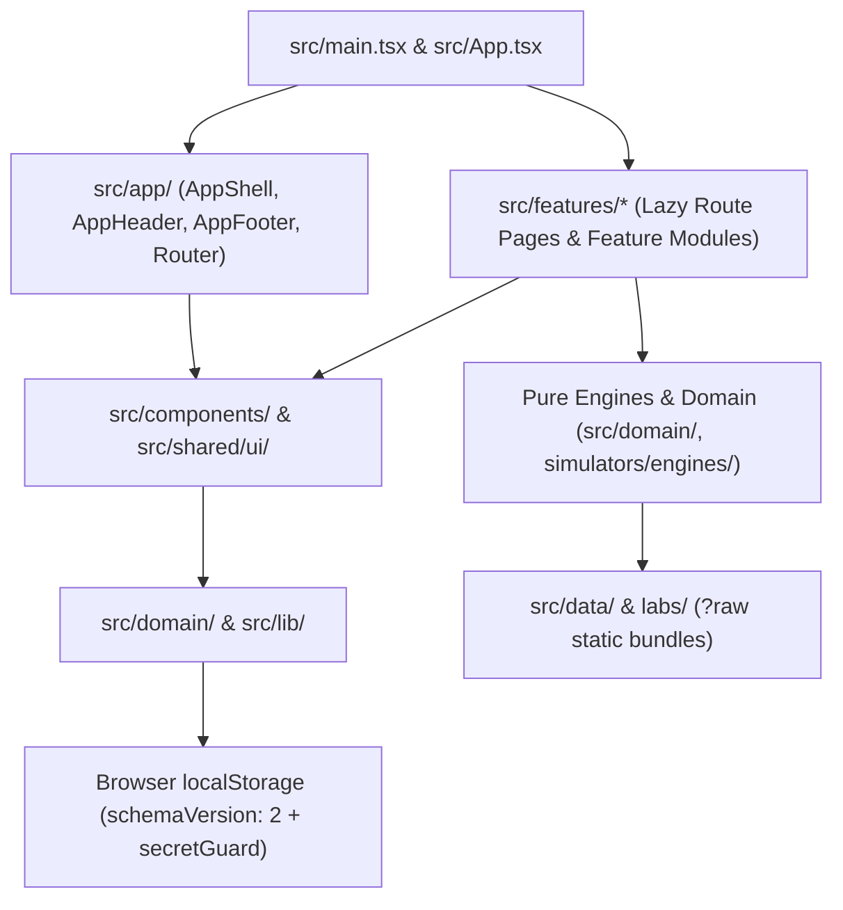
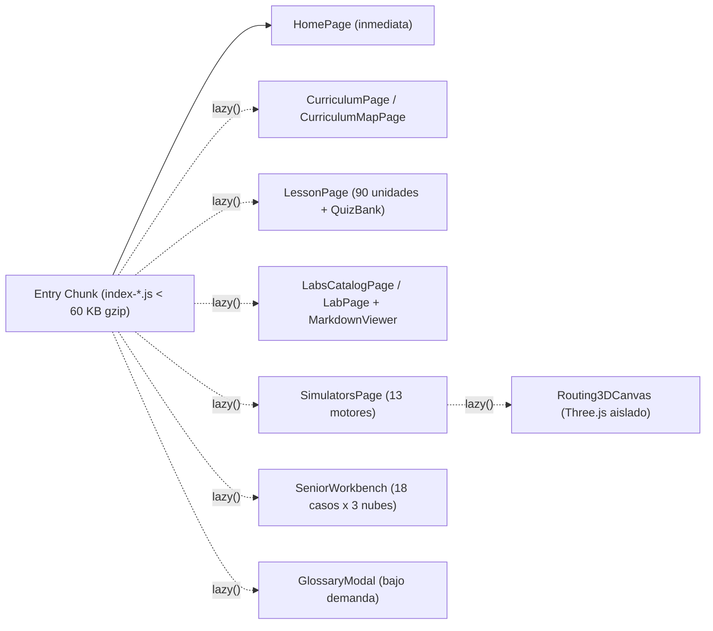

# Arquitectura Técnica — Cloud Engineering Academy (V10)

## 1. Visión y Límites del Sistema

**Cloud Engineering Academy** es una Single-Page Application (SPA) educativa estática, determinista y 100% local en cliente construida con **Preact 10.27**, **@preact/signals 2.2**, **TypeScript 5.9 (`strict: true`)**, **Vite 7.1** y **Three.js** (carga diferida bajo demanda).

- **Qué SÍ hace:** Enseña ingeniería y arquitectura multicloud (**AWS, Microsoft Azure y Google Cloud**) mediante 18 módulos (90 unidades únicas), 60 prácticas catalogadas, 13 motores puros de simulación, 3 proyectos integradores y 18 incidentes de **Senior Mode** con persistencia local aislada por proveedor.
- **Qué NO hace:** No solicita ni almacena credenciales cloud reales, no despliega infraestructura desde el navegador, no envía telemetría oculta a servidores externos y no emite certificaciones oficiales de AWS, Microsoft ni Google.

---

## 2. Diagrama de Capas y Flujo Unidireccional

### Reglas de Ownership e Invariantes (`F1-04`, `F1-05`)
1. **Unidireccionalidad estricta:** `src/app/`, `src/components/` y `src/shared/` **jamás** importan desde `src/features/`.
2. **Aislamiento entre features:** Ninguna carpeta bajo `src/features/<featureA>` importa desde `src/features/<featureB>`.
3. **Tamaño modular:** Todos los módulos de `app/`, `components/`, `domain/`, `shared/` y `features/` se mantienen bajo **`< 250` líneas**, con `0` ciclos de importación y `0` usos de `any` explícito.
4. **Seguridad DOM:** `0` usos de `innerHTML`, `outerHTML`, `dangerouslySetInnerHTML`, `eval` o `window.confirm()`.

---

## 3. Code-Splitting y Presupuesto de Rendimiento (`F1-08`, `F9-05`)

El script `scripts/check-bundle-budget.mjs` verifica automáticamente tras cada `vite build` que el chunk inicial `index-*.js` permanezca por debajo de **60 KB gzipped** y la hoja `index-*.css` dentro del presupuesto asignado, manteniendo `Routing3DCanvas` (Three.js) en un chunk diferido independiente que solo se descarga cuando el alumno abre `Routing & Firewall Lab`.

---

## 4. Persistencia Local Versionada y Guardrails (`F1-09`, `F2-08`, `F7-06`)

- **Esquema `schemaVersion: 2` (`src/lib/importValidation.mjs`):** Migra de forma pura respaldos heredados V1–V9, filtra claves peligrosas (`__proto__`, `constructor`, `prototype`), acota rangos numéricos y protege `localStorage` corrupto poniéndolo en cuarentena con opción de descarga cruda (`cloud-academy-respaldo-crudo-corrupto.json`) sin ejecutar nunca `localStorage.clear()`.
- **Coordinador de cambio de contexto (`src/lib/contextSwitchGuard.ts`):** Antes de conmutar `AWS ↔ Azure ↔ GCP` o cambiar de ruta, vuelca atómicamente cualquier borrador pendiente en su scope original.
- **Filtro preventivo anti-secretos (`src/lib/secretGuard.mjs`):** Inspecciona notas y reportes antes de persistir o exportar, bloqueando claves `AKIA/ASIA`, `AIza`, `ghp_`, bloques `PRIVATE KEY`, `AccountKey=` y tokens JWT.
